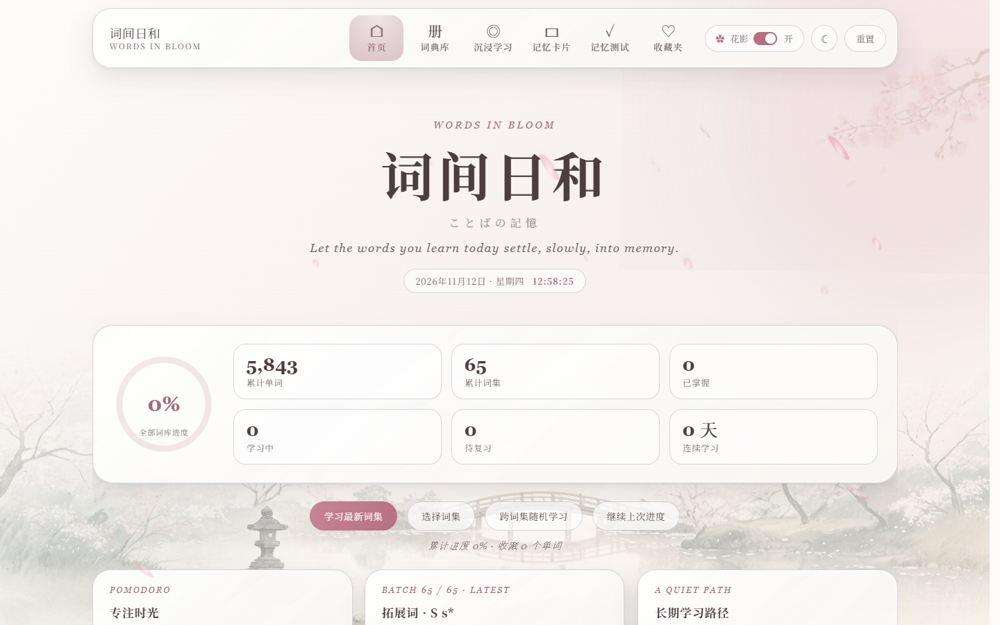
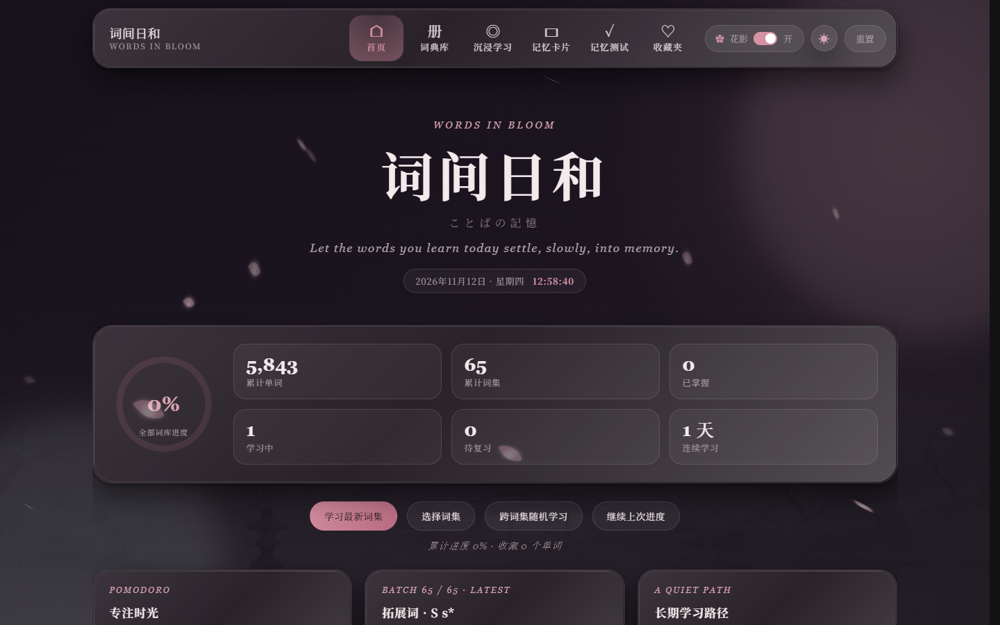
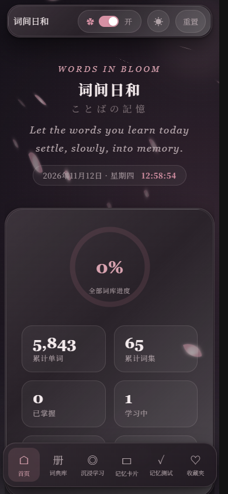

# 词间日和 · Words in Bloom

> ことばの記憶 —— 把背单词做成「一间可以久待的纸本书房」的考研词汇应用。
> 暖粉和风的液态玻璃界面 + 夜樱暗色主题，全程离线可用，学习进度只存在你自己的浏览器里。

[](https://cheshiping.github.io/words-in-bloom/)
[](https://github.com/CheShiping/words-in-bloom/actions/workflows/deploy.yml)


**在线体验 →** https://cheshiping.github.io/words-in-bloom/

---

## 界面预览

| 浅色「暖粉和风」 | 暗色「夜樱」 |
|---|---|
|  |  |

| 沉浸学习 | 移动端（底部导航接管） |
|---|---|
|  |  |

> 首次进入会要求挑选一本词集，弹窗不可跳过——这是「软重启」式的新手引导。

---

## 特性

- **纯静态、零后端**：构建产物是纯 HTML/CSS/JS，放到任何静态托管都能跑；学习进度写入浏览器 `localStorage`，不上传任何数据。
- **六个学习场景**：首页概览 · 词典库 · 沉浸学习 · 记忆卡片 · 记忆测试 · 收藏夹。
- **间隔复习**：答错安排 4 小时后复习，连续答对两次判定「已掌握」；复习时间参与「待复习优先」排序。
- **首访选书引导**：65 期词集 / 5,843 个单词 / 252 个主题分类，首访选一本开始；随时可在首页「选择词集」更换。
- **双主题**：浅色「暖粉和风」与暗色「夜樱」，首帧内联脚本决定主题，切换不闪白。
- **液态玻璃材质**：统一的玻璃文本块 + 内描边 + 对角高光，58 个语义 token 驱动，组件层零硬编码底色。
- **三层动效**：CSS keyframes（花瓣 / 光斑 / 樱枝氛围）→ WAAPI（卡片切换）→ GSAP（页面编排、数字滚动、导航聚光灯）。
- **完整手势层**：卡片左右滑动切换、整页左右滑动翻页，鼠标与触摸同一套 Pointer Events。
- **移动端优先**：768px 起底部导航接管，触摸目标 ≥ 44px，输入框 16px 防 iOS 缩放，`env(safe-area-inset-bottom)` 适配刘海屏。
- **无障碍与降级**：`prefers-reduced-motion` 全面降级、`aria-label` / `aria-valuenow` 齐备、键盘可完整操作。

---

## 交互速查

| 操作 | 效果 |
|---|---|
| `←` `→` | 沉浸学习 / 记忆卡片 / 记忆测试：上一个 · 下一个；首页 / 词典库 / 收藏夹：整页翻页 |
| `M` / `R` / `F` | 标记「已掌握」/「待复习」/ 收藏 |
| `空格` / `Enter` | 翻面记忆卡片 |
| 左右滑动卡片 | 切换上一个 / 下一个（56px 阈值） |
| 左右滑动页面 | 整页翻页（72px 阈值） |
| 双指 / 纵向滑动 | 保留原生页面滚动 |

---

## 设计系统

完整规范见 **[DESIGN_SYSTEM.md](DESIGN_SYSTEM.md)**——暖粉和风 / 夜樱双主题的 token、材质、排版、组件、动效、响应式与无障碍约定，以及一条条「不可违反的硬约定」。

```
app/globals.css      # 全部 token 与组件样式（事实源）
components/BloomApp.jsx  # DOM 结构与动效编排
app/layout.jsx       # 主题首帧脚本
DESIGN_SYSTEM.md     # 规范与硬约定
```

核心原则速览：

1. **文本块主题统一**——全站只有一种内容容器 `.glass`，靠留白、圆角、字号与玻璃叠层区分层级。
2. **变量优先**——浅色 / 暗色只覆盖 `:root` 与 `[data-theme="dark"]`，组件不写死底色。
3. **复用优先于新增**——新面板组合 `.journal-card` / `.badge` / `.path-bar` / `.pill`，不另造一套组件。
4. **动效分层且克制**——氛围走 CSS、状态切换走 WAAPI、编排走 GSAP，减弱动效一律降级。
5. **阅读优先**——模糊仅 11px、长内容 `overflow-wrap: anywhere`、数字统一 `tabular-nums`。
6. **移动端是主战场**——44px 触摸目标、按下态替代 hover、底部导航接管。

---

## 技术栈

| | |
|---|---|
| 框架 | [Next.js 15.5](https://nextjs.org)（App Router + 静态导出） |
| UI | [React 19](https://react.dev) + 纯 CSS（无 UI 框架、无 Tailwind、无 CSS-in-JS） |
| 动效 | [GSAP 3.13](https://gsap.com) + Web Animations API |
| 数据 | 静态 JSON（`public/data/catalog.json`）+ 浏览器 `localStorage` |
| 部署 | GitHub Pages（GitHub Actions 自动构建发布） |

---

## 快速开始

```bash
# 环境要求：Node.js ≥ 18.18
npm install
npm run dev          # http://localhost:3000
```

构建与预览静态产物：

```bash
npm run build        # 产物输出到 out/
npm run start        # 本地预览 out/
```

> 如果部署在域名根路径以外的子路径（如 GitHub Pages 的 `/仓库名`），构建前设置 `NEXT_PUBLIC_BASE_PATH`：

```bash
NEXT_PUBLIC_BASE_PATH=/words-in-bloom npm run build   # macOS / Linux
# PowerShell: $env:NEXT_PUBLIC_BASE_PATH = "/words-in-bloom"; npm run build
```

---

## 目录结构

```
.
├─ app/
│  ├─ globals.css          # 设计系统：token、材质、组件、响应式、双主题
│  ├─ layout.jsx           # 主题首帧脚本（避免暗色闪白）+ metadata
│  ├─ page.jsx             # 入口
│  └─ assets/              # 水彩庭园底景与樱枝素材
├─ components/
│  └─ BloomApp.jsx         # 全部界面与动效编排
├─ public/data/
│  └─ catalog.json         # 词库（65 期词集 / 5,843 词 / 252 主题）
├─ scripts/
│  └─ build_catalog.py     # 从 Excel 重新生成词库
├─ docs/images/            # README 截图
└─ DESIGN_SYSTEM.md        # 设计系统规范与硬约定
```

---

## 更新词库

词库由 `public/data/catalog.json` 提供，附带 Excel 转换脚本（需要 Python 与 `openpyxl`）：

```bash
python -m pip install openpyxl
npm run catalog                                   # 使用默认工作簿路径
python scripts/build_catalog.py <工作簿.xlsx> <输出.json>   # 或指定路径
```

---

## 部署到 GitHub Pages

仓库内置 `.github/workflows/deploy.yml`：推送到 `main` 即自动构建静态产物并发布到 GitHub Pages。

1. 仓库 **Settings → Pages → Build and deployment → Source** 选 **GitHub Actions**；
2. 推代码：

```bash
git add .
git commit -m "feat: 词间日和 v1"
git push origin main
```

3. 等待 Actions 跑完，访问 <https://cheshiping.github.io/words-in-bloom/>。

工作流会用 `NEXT_PUBLIC_BASE_PATH=/<仓库名>` 构建，因此页面与静态资源路径一致，部署在子路径下也能正常工作。

---

## 许可与致谢

- 代码与设计遵循 [MIT License](LICENSE)。
- 词库数据来自《考研单词 5920》工作簿，仅用于个人学习。
- 底景与樱枝素材为项目自带的水彩贴图。

> 本项目为设计系统课程作业，愿你在其中久坐。
